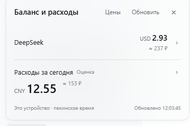
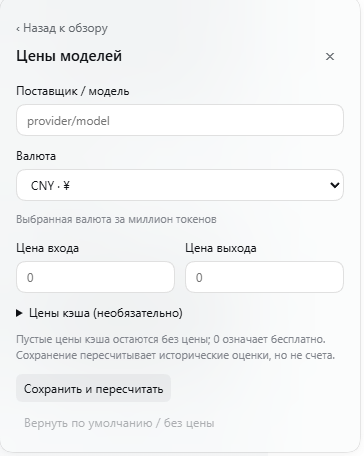

# Balance and spending (RUB) for DeepSeek Harness

[](https://github.com/artuasova/dsh-balance-ru/actions/workflows/ci.yml)
[](https://github.com/artuasova/dsh-balance-ru/releases)
[](LICENSE)

Unofficial fork of [`@pipilu123566/dsh-balance`](https://github.com/pipilu123566/deepseek-harness-plugin)
that adds a ruble approximation at the CBR (Bank of Russia) daily rate and a bundled
Russian UI dictionary.

- Repository: <https://github.com/artuasova/dsh-balance-ru>
- Prebuilt archive: [`dsh-balance-ru-1.2.0.tgz`](../../releases/download/v1.2.0/dsh-balance-ru-1.2.0.tgz)
  (all versions on the [Releases](../../releases) page)

## Screenshots



*Overview: available balance and today's spending. The `≈ 237 ₽` / `≈ 153 ₽` lines are an
approximate CBR-rate conversion; the original USD/CNY amounts are untouched.*



*Model prices: per-model input/output/cache prices in CNY or USD.*

Screenshots come from a working DeepSeek Harness 0.2.1-rc.5 installation; amounts are the
actual balances at capture time.

## Features

- Provider balances (DeepSeek account, official DeepSeek API, OpenRouter, SiliconFlow, …).
- Ruble approximation next to every amount, from the CBR daily rate (USD and CNY).
  Display only: amounts keep their currency and are never summed across currencies.
- Today's spending with model and session breakdowns and per-turn costs.
- Configurable per-model input/output/cache prices, recalculating historical estimates.
- Explicit errors, missing credentials and unpriced calls instead of fake zeros.
- Bundled Russian dictionary and the `ru` language row; no separate language pack required.

## Requirements

- DeepSeek Harness **0.2.1-rc.5** (Desktop), enforced by `engines.dsh`.
- Internet access for the exchange rate (cached 6 hours; otherwise no ruble line).

## Install

1. Fully quit DeepSeek Harness.
2. Download [`dsh-balance-ru-1.2.0.tgz`](../../releases/download/v1.2.0/dsh-balance-ru-1.2.0.tgz).
3. Remove the original plugin unless only one balance plugin is installed:
   `dsh plugin --profile desktop remove @pipilu123566/dsh-balance`
4. Add the tarball:
   `dsh plugin --profile desktop add ./dsh-balance-ru-1.2.0.tgz --ignore-scripts`
5. Start Harness and use the **Balance** button at the bottom of the sidebar.

Switch the plugin UI to Russian with **Settings → General → Language → Russian** (the plugin
registers the `ru` language itself; other Harness strings follow the installed language
pack and fall back to English).

## Exchange rate

- `https://www.cbr-xml-daily.ru/daily_json.js` (CORS-enabled CBR mirror), fallback
  `https://open.er-api.com/v6/latest/USD`.
- Cached 6 hours; the value is approximate (`≈`) and the tooltip shows the rate date.
- The browser fetches the rate; balance and usage data still come only from Harness services.

## Differences from upstream 1.1.0

Ruble approximation, bundled Russian dictionary and `ru` language registration, renamed
distribution (`dsh-balance-ru`, slot ids `dsh-balance-ru` / `dsh-balance-ru-turn`), hot-reload
resilience for locale registration, localized display metadata, new `rub.test.js`.
Internal service names (`pipiluBalance`, `pipiluTokenUsage`, locale namespace `pipilu.balance`)
are kept from upstream.

## Build and test

```sh
npm install
npm test   # 30 tests
npm pack   # dsh-balance-ru-1.2.0.tgz
```

## License

MIT. Original work Copyright (c) 2026 pipilu123566 — see [`LICENSE`](LICENSE) and
[`NOTICE.md`](NOTICE.md). Unofficial fork, not affiliated with DeepSeek or with the upstream
author.
